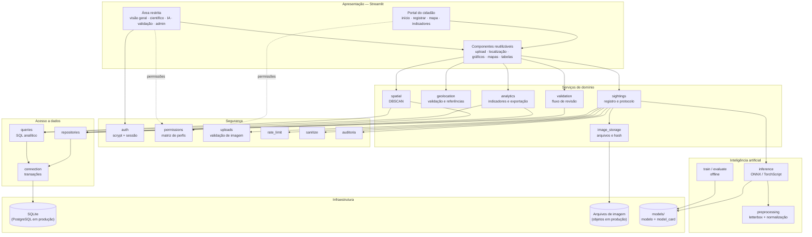
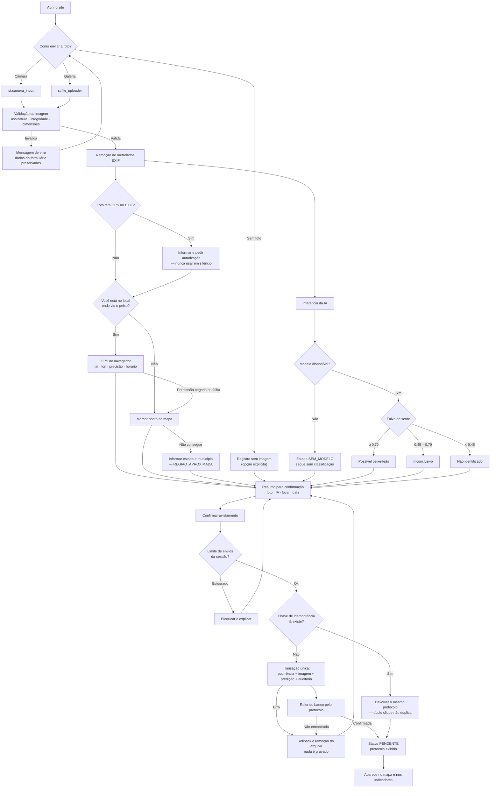
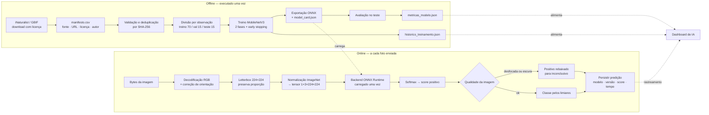
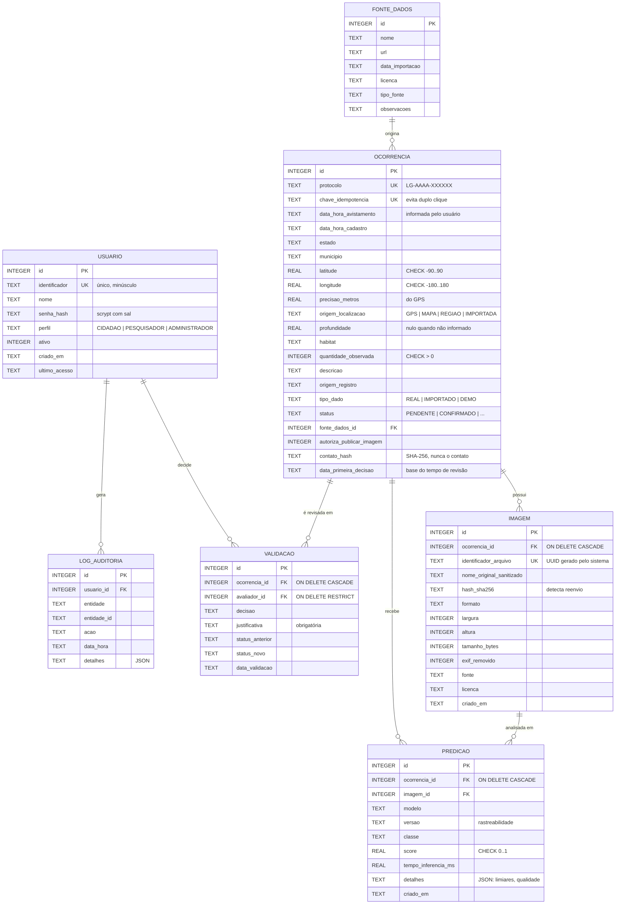
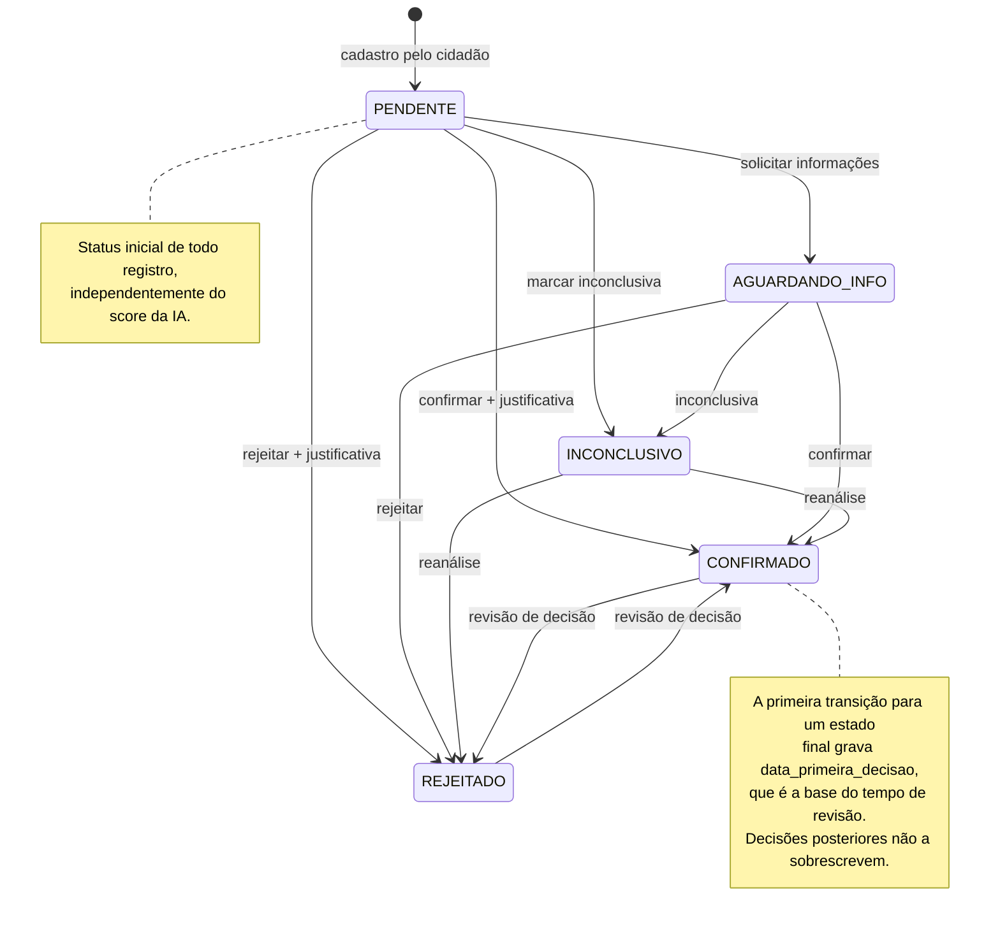
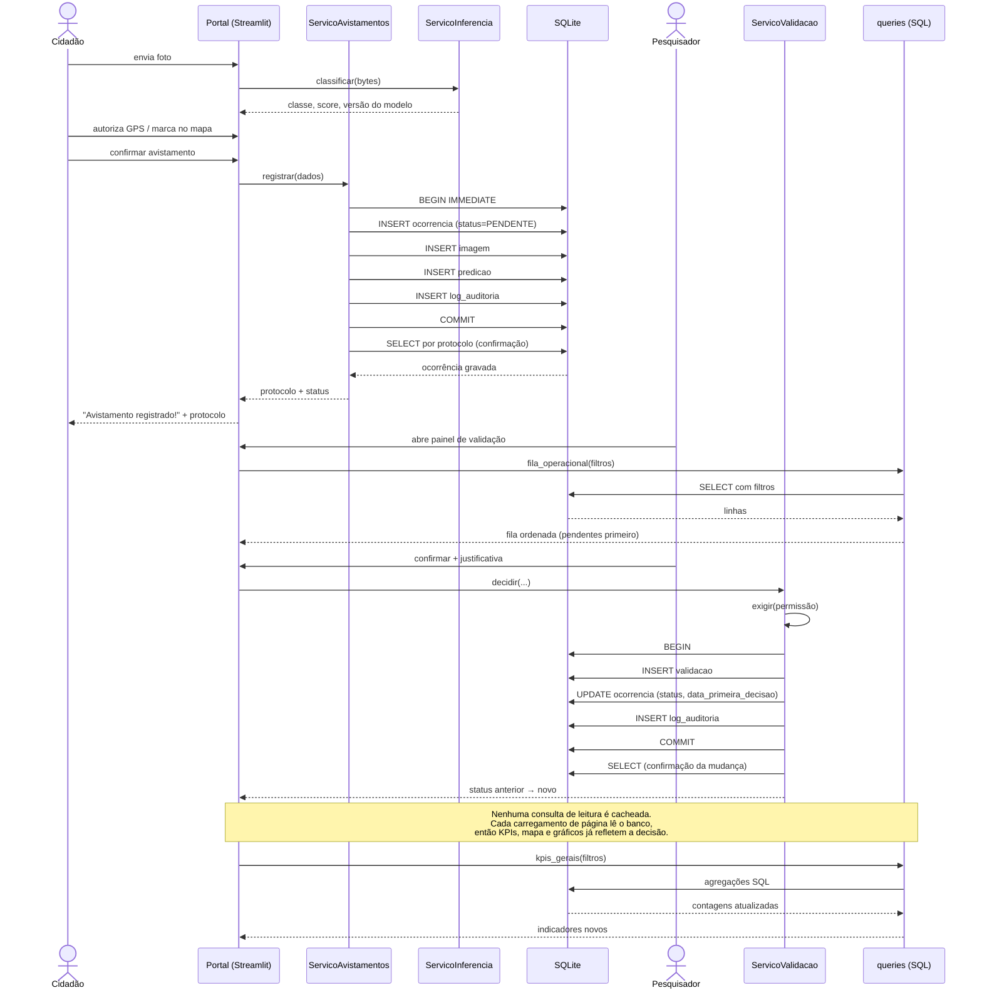

# Arquitetura do LionGuard AI

Documento técnico da arquitetura, dos fluxos e do modelo de dados. Os diagramas
estão em Mermaid e são renderizados diretamente pelo GitHub.

---

## 1. Visão geral dos componentes

A aplicação separa interface, serviços de domínio, acesso a dados e
infraestrutura. A regra é que a interface **nunca** fala com o banco: ela chama
serviços, e os serviços usam repositórios. Isso é o que permite testar toda a
regra de negócio sem subir o Streamlit — e é por isso que a suíte de testes
cobre o fluxo completo sem navegador.



---

## 2. Fluxo do avistamento (caminho do cidadão)

Cada etapa só aparece na tela quando a anterior está resolvida, para não
apresentar um formulário longo no celular. Nenhuma falha intermediária
interrompe o registro: IA indisponível e GPS negado têm caminhos alternativos.



---

## 3. Fluxo da inteligência artificial



**Ponto importante:** não existe caminho de código que produza classe ou score
sem executar o modelo. Sem modelo publicado, o resultado é `SEM_MODELO`; se a
inferência falhar, é `ERRO`. Nos dois casos o avistamento é gravado e segue
para revisão humana.

---

## 4. Modelo entidade-relacionamento



Além dessas, a tabela `evento_requisicao` (sem relacionamento) sustenta a
limitação de envios por sessão.

**Índices** (15 no total): status, estado, município, tipo de dado, datas de
avistamento e cadastro, par (latitude, longitude), ocorrência e hash em
`imagem`, ocorrência e versão em `predicao`, ocorrência e data em `validacao`,
entidade em `log_auditoria` e a chave composta de `evento_requisicao`.

---

## 5. Fluxo de validação



Toda transição exige: sessão autenticada com a permissão
`VALIDAR_OCORRENCIA`, justificativa com no mínimo 10 caracteres, e grava
simultaneamente — na mesma transação — o registro em `validacao`, a mudança em
`ocorrencia` e o evento em `log_auditoria`.

---

## 6. Atualização dos dashboards



---

## 7. Decisões de arquitetura e seus motivos

| Decisão | Alternativa descartada | Por quê |
| --- | --- | --- |
| Serviços independentes da interface | Lógica dentro das páginas Streamlit | Permite testar o fluxo completo sem navegador — 569 testes rodam em ~5 s |
| SQL explícito em `queries.py` | ORM | Modelagem e consultas ficam auditáveis e evidenciam a disciplina de banco; as agregações são legíveis |
| Transação única por operação | Gravações sequenciais | Uma falha no meio não deixa ocorrência sem imagem nem arquivo órfão |
| Chave de idempotência derivada do conteúdo | Bloqueio de botão no front-end | Resiste a recarregar a página, não só ao duplo clique |
| Classificação (CNN) em vez de detecção (YOLO) | YOLO | Base de imagens limitada; um detector com poucas anotações de caixa seria pior e sugeriria capacidade que não existe |
| Três respostas da IA | Binária | A faixa intermediária existe de verdade; forçá-la a uma decisão produz erro silencioso |
| `SEM_MODELO` como estado de primeira classe | Fallback silencioso | Interface honesta: o usuário sabe que não houve análise automática |
| Coordenada pública arredondada em SQL | Arredondamento na interface | A coordenada precisa não sai do banco para a camada pública |
| Nenhum cache nas consultas de leitura | `st.cache_data` | Garante que um registro novo apareça na consulta seguinte, sem invalidação manual |
| Conexão por thread | Conexão global | O Streamlit usa um pool de threads e o SQLite não compartilha conexão entre elas por padrão |
| Rate limit em tabela | Em memória | Estado de sessão do Streamlit é reconstruído com facilidade; em memória seria contornável recarregando |
| Demonstração sem predição de IA | Scores sintéticos | Score fabricado é resultado de modelo inventado |
| Tema escuro com paletas revalidadas | Inverter o tema claro | Painel é lido em ambiente escuro; a inversão falha na faixa de luminosidade, então os passos foram refeitos e verificados contra a nova superfície |
| Blocos do painel em HTML/SVG | Um gráfico por número | Bloco de número, barra e medidor não precisam de biblioteca de gráficos, e assim ficam testáveis sem navegador |
| HTML normalizado antes do `st.markdown` | Escrever a marcação direto | O Streamlit roda Markdown antes de liberar o HTML: recuo de 4 espaços vira bloco de código e linha em branco encerra o bloco. Normalizar no centro resolve de uma vez, e um teste varre o código |
| `app/paginas/` em vez de `app/pages/` | Nome padrão | `st.navigation` com um diretório `pages/` ao lado do arquivo de entrada gera aviso de comportamento indeterminado |
| Ilustração em SVG gerado por código | Imagem baixada da internet | Nenhuma questão de licença, o desenho segue a paleta do projeto e a geometria fica testável (`tests/test_ilustracoes.py`) |
| Fotografias buscadas em tempo de execução | Cópias no repositório | Não redistribuímos arquivos de terceiros, a licença é lida da fonte na hora e o acervo melhora sozinho; sem internet a seção se declara indisponível |
| Lista de vídeos vazia por padrão | Links embutidos no código | Um endereço embutido é uma afirmação que ninguém conferiu; o grupo preenche `data/conteudo_educativo.json` |
| Batimetria como camada padrão do mapa | Mapa de ruas | Em um projeto marinho, plataforma continental e profundidade explicam a distribuição; a camada de ruas continua disponível |
| Cache apenas na galeria de fotos | Cache nas consultas ao banco | A galeria é uma chamada externa lenta e imutável por uma hora; os dados do banco precisam refletir o registro novo imediatamente |

---

## 8. Estrutura de diretórios

```text
lionguard-ai/
├── app/                      interface Streamlit
│   ├── main.py               roteador e navegação por perfil
│   ├── paginas/              11 páginas (6 públicas, 5 restritas)
│   ├── components/           componentes reutilizáveis (board, mapas, mídia, gráficos)
│   └── styles/               tema escuro, normalizador de HTML e ilustrações em SVG
├── src/
│   ├── ai/                   preprocessing · inference · train · evaluate
│   ├── data/                 dataset · demo_seed · importers · galeria · conteudo
│   ├── database/             schema · connection · models · repositories · queries
│   ├── services/             sightings · geolocation · image_storage · validation · analytics · spatial
│   ├── security/             auth · permissions · uploads · rate_limit · sanitize
│   └── config.py             configuração por variáveis de ambiente
├── data/                     raw · processed · images · banco SQLite
├── models/                   modelo exportado + model_card.json
├── reports/                  métricas, evidências e resultado dos testes
├── scripts/                  CLIs de dataset, treino, avaliação, evidências e diagnóstico
├── tests/                    11 arquivos de teste (569 casos)
├── docs/                     esta documentação e o PDF da entrega
├── requirements.txt          dependências da aplicação
└── requirements-treino.txt   dependências extras para treinar
```
